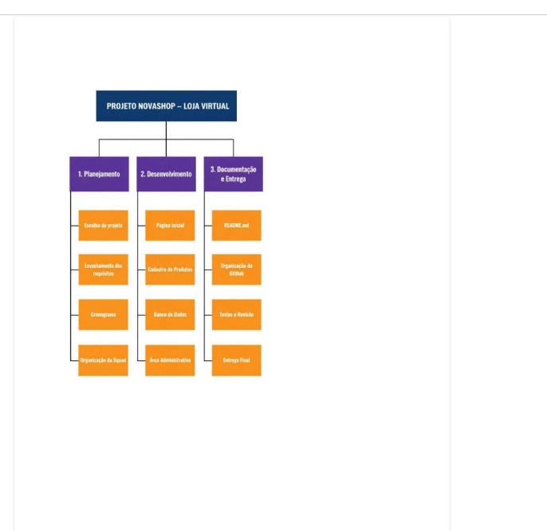

# 🎾 Site Tênis

## 📋 Descrição do Projeto

O projeto Site Tênis tem como objetivo desenvolver uma interface web relacionada ao universo do tênis, organizando inicialmente a documentação, o planejamento, os wireframes e a estrutura do projeto para a próxima etapa de desenvolvimento.

O projeto está sendo desenvolvido durante o curso Técnico em Desenvolvimento de Sistemas, utilizando ferramentas como Visual Studio Code, Git e GitHub.

---

## 🎯 Objetivo

O objetivo do projeto é planejar e estruturar o desenvolvimento de um site sobre tênis antes do início da codificação em HTML.

Nesta etapa foram realizados o planejamento da interface, a criação dos wireframes, a organização da estrutura de pastas, o Code Review e a documentação inicial do projeto.

---

## 📌 Etapa Atual

O Projeto 01 está na etapa de fechamento do dossiê e preparação para a SA 01 de HTML.

Nesta etapa estão sendo organizados:

- Documentação do projeto;
- EAP e Cronograma;
- Wireframes;
- Estrutura de pastas;
- Code Review;
- Repositório Git;
- README.md.

---

## 📊 EAP e Cronograma

A EAP e o cronograma apresentam as etapas planejadas para o desenvolvimento do projeto.

### EAP

A Estrutura Analítica do Projeto organiza as principais atividades necessárias para o desenvolvimento do sistema, desde o planejamento inicial até as etapas de desenvolvimento.

### Cronograma

O cronograma apresenta a organização das atividades e das próximas etapas do projeto.

A imagem da EAP/Cronograma está disponível na pasta `docs`.



---

## 🖼️ Wireframes

Os wireframes foram desenvolvidos durante a etapa de UX e representam a estrutura visual das páginas do projeto antes da implementação em HTML e CSS.

Os arquivos dos wireframes estão organizados na pasta:

`docs/wireframes`

---

## 🔎 Code Review

Foi realizado um Code Review do projeto para analisar a organização e a estrutura dos arquivos desenvolvidos.

O documento do Code Review está disponível no arquivo:

`Code_Review_Site_Tenis.pdf`

---

## 📁 Estrutura do Projeto

```text
site_tenis/
│
├── .git/
│
├── assets/
│   ├── icons/
│   └── images/
│
├── css/
│
├── docs/
│   ├── EAP_Cronograma.png
│   └── wireframes/
│
├── js/
│
├── Code_Review_Site_Tenis.pdf
│
└── README.md

---
# Relatório — Introdução à Web e Linguagens de Marcação

## Parte 1 — Engenharia Reversa de Sintaxe

### 1. Semântica personalizada de dados

O Trecho C (XML), porque ele permite criar tags personalizadas para representar os dados sem se preocupar com a aparência deles na tela.

### 2. Documentação de código

O Markdown, porq+e é simples, rápido de escrever e muito utilizado para criar arquivos de documentação, como o README.md de projetos no GitHub.

### 3. Página principal de uma loja virtual

O HTML5, porque ele é responsável por criar a estrutura da página. O CSS pode ser usado para a aparência e o JavaScript para as funcionalidades.

## Parte 2 — Auditoria de Infraestrutura

### 1. Registro de domínio

Valor do domínio .com.br por 1 ano: **R$ XX,XX**.

Também é possível registrar o domínio por períodos maiores.

### 2. Rastreamento de IP

Comando utilizado:

`ping senai.br`
IPv4 retornado:
**191.233.16.218**


### 3. Whois 
Domínio analisado: `uol.com.br`

- **Entidade/Empresa:** A PR
  - A PREENCHER
EENCHER
- **Data de criação:** A PREENCHER
- **Data de expiração:** A PREENCHER
- **Servidores DNS:**
  - A PREENCHER+


#  - Especificacoes de UI UX

## 1. Conceitos de Usabilidade em Formularios

### Labels vs Placeholders

Os campos de formulario devem possuir labels visiveis para identificar claramente a informacao que deve ser preenchida.

O placeholder nao deve substituir a label, pois desaparece quando o usuario comeca a digitar e pode dificultar a identificacao do campo. Ele pode ser utilizado como uma orientacao ou exemplo complementar.

Exemplo:

```text
E-mail
[ exemplo@email.com             ]
```

Nesse caso, "E-mail" e a label e "[exemplo@email.com](mailto:exemplo@email.com)" e o placeholder.

### Hierarquia Visual

Os elementos da interface devem possuir diferentes niveis de destaque de acordo com sua importancia.

* Primary Button: representa a acao principal da tela, como "Entrar", e deve possuir maior destaque visual.
* Secondary Actions: representam acoes complementares, como "Criar conta" e "Esqueci minha senha", possuindo menor destaque visual.

Essa hierarquia ajuda o usuario a identificar rapidamente a acao mais importante.

---

## 2. Estados de Validacao dos Campos de Entrada

Os campos de entrada devem apresentar diferentes estados visuais para informar ao usuario sua situacao atual.

### Default - Padrao

E o estado inicial do campo.

Diretrizes:

* Borda neutra.
* Label claramente visivel.
* Texto com contraste adequado.
* Campo facilmente identificavel.

### Focus - Foco

Ocorre quando o usuario seleciona o campo ou navega ate ele utilizando o teclado.

Diretrizes:

* Alteracao visual da borda.
* Utilizacao de outline ou anel de foco.
* Indicador de foco claramente visivel.
* Contraste suficiente entre o campo e o fundo.

O indicador de foco permite que usuarios que navegam pelo teclado saibam qual elemento esta selecionado.

### Error - Erro

Indica que o preenchimento apresenta algum problema.

Diretrizes:

* Borda em vermelho ou outro indicador visual.
* Mensagem explicativa abaixo do campo.
* Informacao clara sobre o problema.
* Orientacao sobre como corrigir o erro.
* O erro nao deve ser indicado somente atraves da cor.

Exemplo:

```text
E-mail
[ email-invalido             ]
E-mail invalido. Digite um endereco valido.
```

### Success - Sucesso

Indica que o campo foi preenchido corretamente.

Diretrizes:

* Indicador visual de preenchimento correto.
* Possibilidade de utilizar uma mensagem de confirmacao.
* Mensagem ou indicacao clara de sucesso.
* A informacao nao deve depender exclusivamente da cor.

Exemplo:

```text
E-mail
[ usuario@email.com          ]
Preenchimento correto.
```

### Disabled - Desabilitado

Indica que o campo esta temporariamente indisponivel para interacao.

Diretrizes:

* Aparencia visual diferente dos campos ativos.
* Contraste reduzido pode ser utilizado para demonstrar indisponibilidade.
* O estado deve ser facilmente diferenciado de um campo ativo.

---

## 3. Padroes de Acessibilidade

### Contraste de Cores

O projeto deve seguir as recomendacoes da WCAG 2.2 para garantir boa legibilidade.

* Texto normal: contraste minimo de 4,5:1.
* Texto grande: contraste minimo de 3:1.
* Elementos importantes nao devem depender apenas da cor para transmitir informacoes.

O contraste adequado melhora a leitura para usuarios com diferentes niveis de visao.

### Navegacao por Teclado

O sistema deve permitir a navegacao atraves do teclado, especialmente utilizando a tecla Tab.

A ordem de navegacao deve ser logica, por exemplo:

```text
E-mail -> Senha -> Entrar -> Esqueci minha senha -> Criar conta
```

O elemento atualmente selecionado deve possuir um indicador visual de foco.

### Leitores de Tela

Os campos e controles devem possuir nomes e labels claros para que leitores de tela consigam identificar corretamente sua funcao.

As mensagens de erro tambem devem estar associadas aos respectivos campos para que o usuario consiga compreender o problema e corrigi-lo.

---

## 4. Aplicacao no Projeto Nova-Web

As diretrizes serao aplicadas a tela de Login da Nova-Web da seguinte forma:

| Elemento            | Aplicacao                              |
| ------------------- | -------------------------------------- |
| Labels              | Identificacao permanente dos campos    |
| Placeholders        | Exemplos ou orientacoes complementares |
| Botao Entrar        | Primary Button                         |
| Criar conta         | Acao secundaria                        |
| Esqueci minha senha | Acao secundaria                        |
| Estado Default      | Borda neutra                           |
| Estado Focus        | Borda ou outline destacado             |
| Estado Error        | Indicador vermelho e mensagem          |
| Estado Success      | Indicador de preenchimento correto     |
| Estado Disabled     | Contraste reduzido                     |
| Contraste           | Minimo de 4,5:1 para texto normal      |
| Teclado             | Navegacao atraves da tecla Tab         |
| Leitor de tela      | Labels e mensagens identificaveis      |

---

## Referencias

* W3C WAI - Labeling Controls
  https://www.w3.org/WAI/tutorials/forms/labels/

* W3C WAI - Form Instructions
  https://www.w3.org/WAI/tutorials/forms/instructions/

* W3C WAI - Form Notifications
  https://www.w3.org/WAI/tutorials/forms/notifications/

* WCAG 2.2 - Contrast Minimum
  https://www.w3.org/WAI/WCAG22/Understanding/contrast-minimum

* WCAG 2.2 - Focus Visible
  https://www.w3.org/WAI/WCAG22/Understanding/focus-visible
